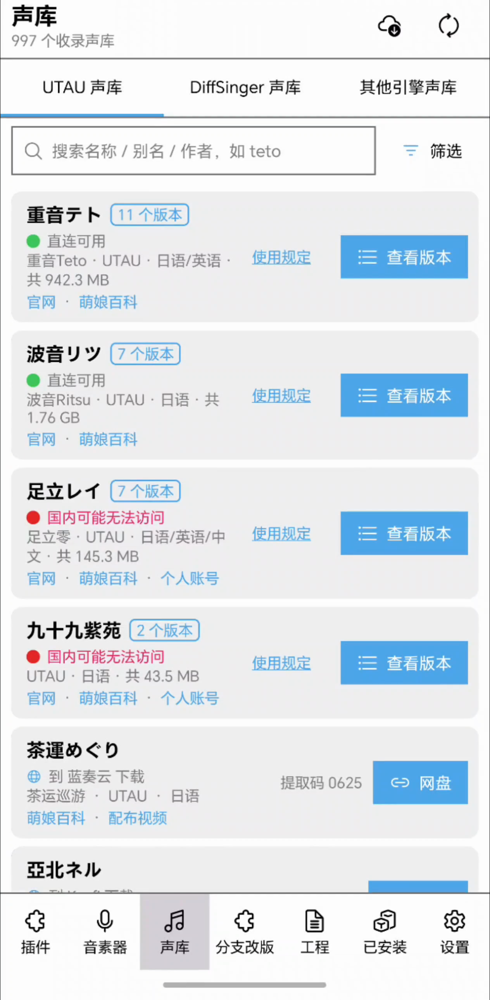
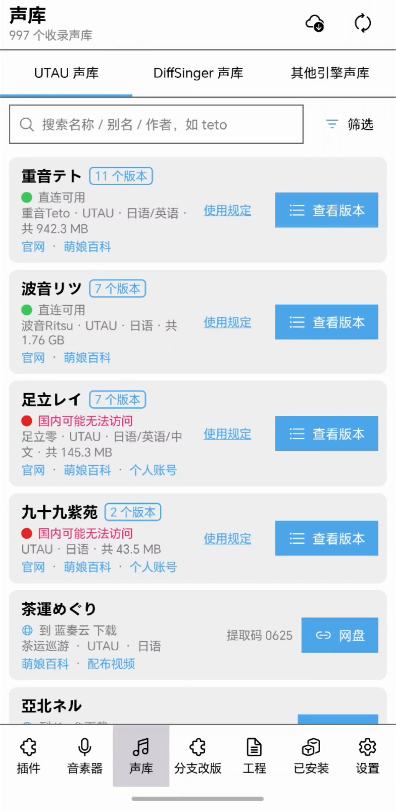
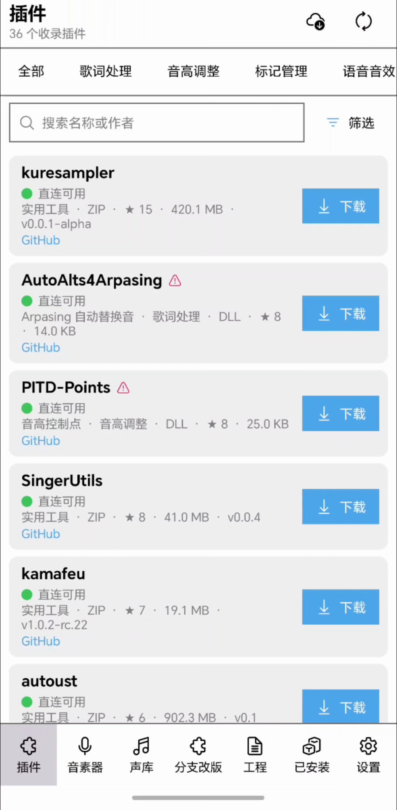

# UtauLibrary Mobile

> [简体中文](README.md) ｜ **English**

[](https://github.com/USER/UtauLibrary-Mobile/actions/workflows/android.yml)
[](LICENSE)
[](https://developer.android.com)
[](https://kotlinlang.org)
[](CHANGELOG.md)

A voicebank, plugin and phonemizer manager for [OpenUtau Mobile](https://github.com/stakira/OpenUtau), plus a downloader.

**Division of labour**: OpenUtau Mobile is for making music; UtauLibrary Mobile is for finding resources, downloading them, installing them and diagnosing problems.

This is a standalone APK. It does not modify OpenUtau Mobile's source and does not depend on it at runtime.

<p align="center">
  
  
  
</p>

---

## Contents

- [What it is for](#what-it-is-for)
- [Features](#features)
- [Install](#install)
- [First run](#first-run)
- [Build](#build)
- [Project layout](#project-layout)
- [Resource manifest](#resource-manifest)
- [FAQ](#faq)
- [Known issues](#known-issues)
- [Contributing](#contributing)
- [License and credits](#license-and-credits)

---

## What it is for

OpenUtau Mobile answers "how do I tune a voice". It does not answer "where do voicebanks come from, where should the download go, and did it install correctly".

UtauLibrary Mobile covers that part:

| Stage | What the app does |
|---|---|
| Find | A built-in catalog, filterable by language, engine, recording type, source, size and network status |
| Download | Chunked multi-connection transfer, resume, automatic retry, route switching |
| Install | Detects the directory structure after extraction and places it into `Singers` / `Plugins` / `Phonemizers` |
| Check | Installed list with real size and file count, health check, failure logs |

---

## Features

### 🎙️ Catalog

- **990+ voicebanks**, **71 plugins and phonemizers**, **8 fork builds**
- Every entry carries name, author, language, recording type (CV / VCV / CVVC), engine, size, version, source platform and a short description
- UTAU, DiffSinger and native OpenUtau formats are listed together

### 🔍 Search and filters

- Search accepts Chinese, Japanese and romaji: typing `teto` finds 重音テト
- Combined filters: language, engine, recording type, source, size range, network status
- Information-only entries (no download link) can be hidden by default

### ⬇️ Download

- Chunked multi-connection download, thread count configurable at 8 / 16 / 32 / 48 / 64 (32 recommended)
- Resume after pause, no restart from zero
- Automatic retry with increasing back-off (2 / 6 / 12 / 20 seconds)
- Falls back to a mirror route when GitHub is unreachable
- Falls back to a single connection when a server ignores `Range`, instead of writing a broken file
- Verifies byte count and archive entry count after download; problems are written to a diagnostic log

### 📦 Install

- Sniffs the real type from the archive content instead of trusting the manifest: voicebank markers > `plugin.txt` > `.dll`
- Handles nesting: deep directories and archives inside archives are expanded automatically
- Verifies after writing: per-file byte count, then file count and total size for the whole folder
- Warns when a voicebank is missing `character.yaml` or audio files instead of failing silently

### 🧩 Installed

- Four tabs: voicebanks, plugins, phonemizers and apps
- Shows real size, file count and last modified time; names prefer the `name=` field of `character.txt`
- Multi-select delete, open containing folder, one-tap health check, leftover cleanup
- Refreshes immediately after an install or a delete
- Search is per tab: searching voicebanks never returns plugins

### 🎨 Interface

- Follows OpenUtau's visual language: 0 corner radius, 1px borders, flat, dense
- 10 colour schemes taken from OpenUtau's own `DarkTheme.axaml` / `LightTheme.axaml`
- Dark and light follow the system; portrait and landscape supported
- Four languages: Simplified Chinese, Traditional Chinese, English, Japanese

---

## Install

1. Download `UtauLibrary-Mobile-1.0.0.apk` from [Releases](https://github.com/USER/UtauLibrary-Mobile/releases)
2. Allow installation from unknown sources, then install
3. Grant one root folder on first launch

| Item | Value |
|---|---|
| App name | UtauLibrary Mobile |
| applicationId | `com.utaumarket.mobile` |
| Version | 1.0.0 (versionCode 10) |
| Minimum | Android 5.0 (API 21) |
| Target SDK | 34 |
| APK size | 9.52 MiB |

---

## First run

1. **Grant a root folder** — any writable directory, for example `/storage/emulated/0/aaa`.
   The app creates `Singers`, `Plugins` and `Phonemizers` inside it and drops a `.nomedia` file so artwork never shows up in your gallery.
2. **Align with OpenUtau** — add the *same* folder to OpenUtau Mobile's *Additional Singer Search Paths*.
   If the two apps point at different folders, OpenUtau will not see what you install here.
3. **Download and install** — tap Download on a catalog entry; the app extracts, detects the structure and places it.
4. **Verify** — open Installed; the health check reports missing files or missing configuration.

> Settings → Directories → "Copy path" puts the current root on the clipboard so you can paste it into OpenUtau.

---

## Build

Requirements: JDK 17, Android SDK (compileSdk 34), Gradle 8.7.

```bash
./gradlew :app:assembleDebug      # debug build
./gradlew :app:assembleRelease    # release build (signing required)
```

Signing values come from environment variables; never commit the keystore:

```bash
export UTM_STORE_PASSWORD=...
export UTM_KEY_ALIAS=...
export UTM_KEY_PASSWORD=...
```

On arm64 Linux, if you hit `AAPT2 Daemon startup failed`, add:

```bash
./gradlew :app:assembleRelease -Pandroid.aapt2FromMavenOverride=/path/to/aapt2
```

See [docs/BUILD.md](docs/BUILD.md) for details.

---

## Project layout

```
app/src/main/
├── assets/
│   └── resource_manifest.json      # the catalog
├── java/com/utaumarket/mobile/
│   ├── archive/                    # extraction and structure detection
│   │   ├── ArchiveExtractor.kt     # zip / rar / 7z / tar.gz
│   │   ├── Installer.kt            # type sniffing and placement
│   │   └── TextEncoding.kt         # Shift-JIS / EUC-JP / UTF-8
│   ├── core/                       # logging, crash reporting, error text
│   ├── data/
│   │   ├── model/                  # data classes
│   │   ├── prefs/                  # settings store
│   │   ├── installed/              # installed scanning, cache, health check
│   │   └── project/                # .ustx project scanning
│   ├── download/                   # download service, chunked downloader, installer
│   ├── saf/                        # storage access framework helpers
│   └── ui/                         # Compose screens and view model
└── res/                            # four locales
```

| Item | Choice |
|---|---|
| Language | Kotlin 1.9.24 |
| UI | Jetpack Compose (BOM 2024.06.00) |
| Build | AGP 8.5.2 / Gradle 8.7 |
| Extraction | Pure JVM: `java.util.zip` + Apache Commons Compress + junrar, no native `.so` |
| File access | SAF (`ACTION_OPEN_DOCUMENT_TREE`), a single root grant |
| Network | OkHttp |
| Icons | Microsoft Fluent UI System Icons (MIT) |

---

## Resource manifest

Every entry lives in `app/src/main/assets/resource_manifest.json`.

| Field | Meaning |
|---|---|
| `name` | The official name given by the author, not the file name |
| `url` | A direct download link; landing pages go to `detail_url` |
| `file_size` | Size in bytes; 0 when unknown |
| `network` | `green` direct / `red` proxy required / `unknown` not probed |
| `remark` | Free-form note; mark overseas netdisk links as proxy-required |

Rules:

- Link to third-party resources only; never redistribute the resources themselves
- Remove the download entry when a link dies, keep the detail page and mark it as dead
- When one voice has several editions, put the year or the size in the name so the right one is picked

---

## FAQ

**Installed but not listed?**
Tap refresh. If it is still missing, check `Download/UtauMarketMobile-extract.txt` to see the directory structure that was actually extracted.

**OpenUtau Mobile cannot find the voicebank I just installed?**
Both apps must point at the same folder. Settings → Directories → Copy path, then paste it into OpenUtau's Additional Singer Search Paths.

**Download fails with 403?**
MediaFire, Dropbox, MEGA and Google Drive reject direct requests; a proxy is required. Those entries are marked as proxy-required in the catalog.

**Downloads are slow?**
Check that the connection count in Settings is at least 16. If the server rejects multiple connections the app falls back to one, and throughput is limited by that single connection. `Download/UtauMarketMobile-download.log` records the thread setting used for each transfer.

**The size looks smaller than expected?**
Older versions stopped counting at 600 files; 1.0.0 fixes that. If it still looks wrong, tap refresh to rescan.

**Can I download without installing?**
Yes — turn off automatic installation in Settings and the archive is saved to the target folder as-is.

---

## Known issues

- Overseas netdisk entries require a proxy; direct requests fail
- If the process is killed during a download, resume may restart from zero
- The projects page is slow on first scan; afterwards it is cached
- Some voicebanks hosted on personal sites have dead links; see `Download/UtauMarketMobile-download.log`

---

## Contributing

Issues and pull requests are welcome. For bug reports please include the app version, Android version, reproduction steps and the three log files from the `Download` folder.

See [CONTRIBUTING.md](CONTRIBUTING.md).

---

## License and credits

Code is released under [MIT](LICENSE).

- Theme colours are taken from [OpenUtau](https://github.com/stakira/OpenUtau)'s `DarkTheme.axaml` / `LightTheme.axaml`
- Icons come from [Microsoft Fluent UI System Icons](https://github.com/microsoft/fluentui-system-icons) (MIT)
- Extraction uses Apache Commons Compress and junrar
- Every voicebank, plugin and phonemizer belongs to its respective author; this repository does not redistribute them

See [THIRD_PARTY_NOTICES.md](THIRD_PARTY_NOTICES.md) for the full list.

This is a third-party community tool. It is not affiliated with, authorised by, or endorsed by the OpenUtau or OpenUtau Mobile projects.
