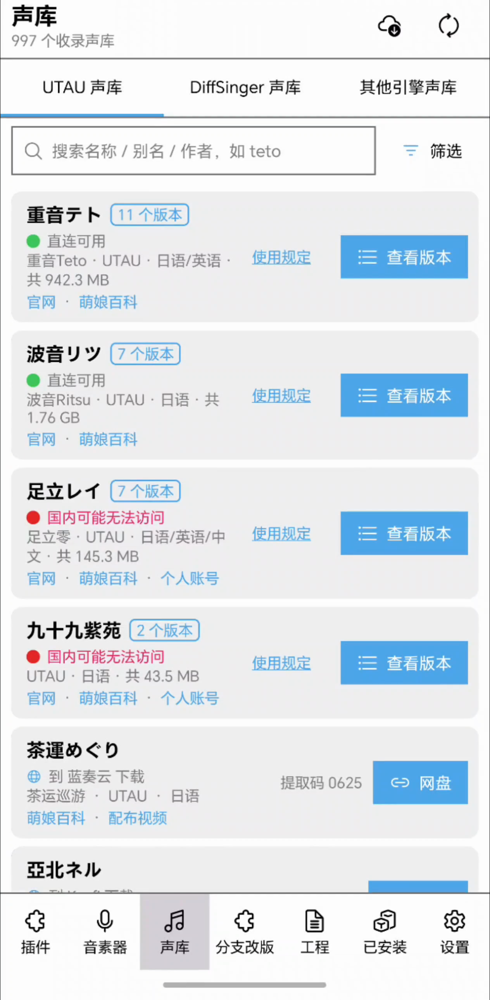
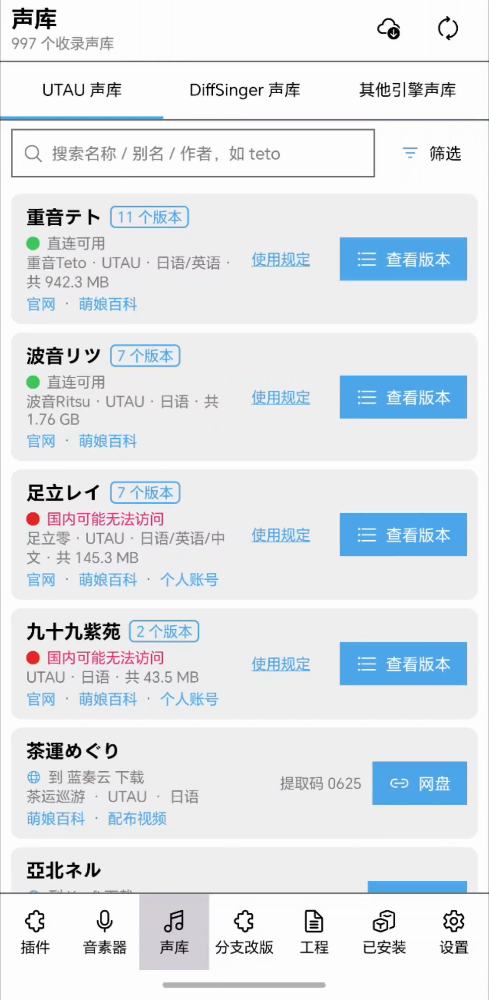
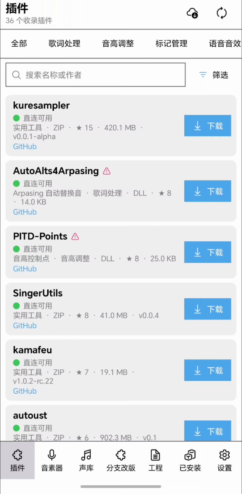

# UtauLibrary Mobile

> **简体中文** ｜ [English](README.en.md)


[](https://github.com/USER/UtauLibrary-Mobile/actions/workflows/android.yml)
[](LICENSE)
[](https://developer.android.com)
[](https://kotlinlang.org)
[](CHANGELOG.md)

面向 [OpenUtau Mobile](https://github.com/stakira/OpenUtau) 的声库、插件与音素器管理器，同时是一个下载器。

**分工**：OpenUtau Mobile 负责创作，UtauLibrary Mobile 负责找资源、下资源、装资源、查问题。

本项目是独立 APK，不修改 OpenUtau Mobile 源码，也不依赖它运行。

<p align="center">
  
  
  
</p>

---

## 目录

- [项目定位](#项目定位)
- [功能](#功能)
- [安装](#安装)
- [首次使用](#首次使用)
- [构建](#构建)
- [项目结构](#项目结构)
- [资源清单](#资源清单)
- [常见问题](#常见问题)
- [已知问题](#已知问题)
- [参与贡献](#参与贡献)
- [许可与致谢](#许可与致谢)

---

## 项目定位

OpenUtau Mobile 解决了「怎么调声」，但没有解决「声库从哪来、下完往哪放、装没装对」。

UtauLibrary Mobile 补上这一段：

| 环节 | 应用做的事 |
|---|---|
| 找 | 内置资源清单，按语言、引擎、录音方式、来源、体积、网络状态筛选 |
| 下 | 多连接分块、断点续传、失败自动重试、线路切换 |
| 装 | 解压后识别目录结构，自动归位到 `Singers` / `Plugins` / `Phonemizers` |
| 查 | 已安装列表、体积与文件数、资源体检、失败日志 |

---

## 功能

### 🎙️ 资源库

- 收录 **990+ 个声库**、**71 个插件与音素器**、**8 个分支改版**
- 每条记录包含名称、作者、语言、录音方式（CV / VCV / CVVC）、引擎、体积、版本、来源平台与简介
- 支持 UTAU、DiffSinger、OpenUtau 原生格式混排展示

### 🔍 检索与筛选

- 关键词搜索支持中文、日文、罗马音：输入 `teto` 可命中「重音テト」
- 组合筛选：语言、引擎、录音方式、来源、体积区间、网络状态
- 可隐藏「仅资料」条目（无直链、只有官网或介绍页的记录）

### ⬇️ 下载

- 多连接分块下载，线程数可设 8 / 16 / 32 / 48 / 64（推荐 32）
- 断点续传：暂停后继续，不必从头开始
- 失败自动重试，间隔逐次延长（2 / 6 / 12 / 20 秒）
- GitHub 直连不通时自动切换加速线路
- 服务器忽略 `Range` 时自动回退单连接，避免写坏文件
- 下载结束后校验字节数与压缩包条目数，异常写入诊断日志

### 📦 安装

- 解压后按内容嗅探类型，不只看清单声明：声库标记 > `plugin.txt` > `.dll`
- 兼容嵌套结构：多层目录、包中包（`.zip` 里再放 `.zip`）自动展开
- 写入后逐项校验：单文件比对字节数，整目录比对文件数与总字节
- 结构异常（缺 `character.yaml`、缺音频）会给出提示，不静默失败

### 🧩 已安装

- 分四类展示：声库 / 插件 / 音素器 / 应用
- 显示真实体积、文件数与更新时间；名称优先取 `character.txt` 的 `name=`
- 支持多选删除、打开所在文件夹、一键体检、清理残留（松散压缩包与空目录）
- 安装或删除后自动刷新列表

### 🎨 界面

- 沿用 OpenUtau 的视觉语言：0 圆角、1px 描边、扁平、高密度
- 10 套配色，逐条取自 OpenUtau 原版 `DarkTheme.axaml` / `LightTheme.axaml`
- 深色与浅色跟随系统���支持横竖屏
- 四种语言：简体中文、繁體中文、English、日本語

---

## 安装

1. 从 [Releases](https://github.com/USER/UtauLibrary-Mobile/releases) 下载 `UtauLibrary-Mobile-1.0.0.apk`
2. 允许「安装未知来源应用」后安装
3. 首次启动按引导授权一个根目录

| 项 | 值 |
|---|---|
| 应用名 | UtauLibrary Mobile |
| applicationId | `com.utaumarket.mobile` |
| 版本 | 1.0.0（versionCode 10）|
| 最低系统 | Android 5.0（API 21）|
| 目标 SDK | 34 |
| 安装包体积 | 9.6 MB |

---

## 首次使用

1. **授权根目录**：任意一个可写目录，例如 `/storage/emulated/0/aaa`。
   应用会在其中创建 `Singers`、`Plugins`、`Phonemizers`，并放一个 `.nomedia` 防止图片进入相册。
2. **对齐 OpenUtau**：打开 OpenUtau Mobile 的 *Additional Singer Search Paths*，加入**同一个目录**。
   两个应用指向不同目录时，OpenUtau 看不到这里装的声库。
3. **下载并安装**：在资源库点「下载」，应用会自动解压、识别结构并归位。
4. **确认结果**：进入「已安装」查看条目与体积；点「体检」可检查缺文件、缺配置的声库。

> 设置 → 目录 → 「复制路径」可以把当前根目录复制到剪贴板，直接粘到 OpenUtau 里。

---

## 构建

环境要求：JDK 17、Android SDK（compileSdk 34）、Gradle 8.7。

```bash
./gradlew :app:assembleDebug      # 调试包
./gradlew :app:assembleRelease    # 发行包（需配置签名）
```

签名通过环境变量注入，密钥不要进仓库：

```bash
export UTM_STORE_PASSWORD=...
export UTM_KEY_ALIAS=...
export UTM_KEY_PASSWORD=...
```

在 arm64 Linux 上构建若遇到 `AAPT2 Daemon startup failed`，追加参数：

```bash
./gradlew :app:assembleRelease -Pandroid.aapt2FromMavenOverride=/path/to/aapt2
```

更多细节见 [docs/BUILD.md](docs/BUILD.md)。

---

## 项目结构

```
app/src/main/
├── assets/
│   └── resource_manifest.json      # 全部收录条目的数据源
├── java/com/utaumarket/mobile/
│   ├── archive/                    # 解压内核与目录结构识别
│   │   ├── ArchiveExtractor.kt     # zip / rar / 7z / tar.gz
│   │   ├── Installer.kt            # 类型嗅探与归位
│   │   └── TextEncoding.kt         # Shift-JIS / EUC-JP / UTF-8 兼容
│   ├── core/                       # 日志、崩溃上报、错误文案
│   ├── data/
│   │   ├── model/                  # 数据模型
│   │   ├── prefs/                  # 设置存储
│   │   ├── installed/              # 已安装扫描、缓存、体检
│   │   └── project/                # .ustx 工程扫描
│   ├── download/                   # 下载服务、分块下载器、安装器
│   ├── saf/                        # 存储访问框架封装
│   └── ui/                         # Compose 界面与 ViewModel
└── res/                            # 四语言资源
```

技术选型：

| 项 | 选择 |
|---|---|
| 语言 | Kotlin 1.9.24 |
| UI | Jetpack Compose（BOM 2024.06.00）|
| 构建 | AGP 8.5.2 / Gradle 8.7 |
| 解压 | 纯 JVM：`java.util.zip` + Apache Commons Compress + junrar，无 native `.so` |
| 文件访问 | SAF（`ACTION_OPEN_DOCUMENT_TREE` + 持久化授权），只申请一个根目录 |
| 网络 | OkHttp |
| 图标 | Microsoft Fluent UI System Icons（MIT）|

---

## 资源清单

所有条目位于 `app/src/main/assets/resource_manifest.json`。新增或修改条目时：

| 字段 | 说明 |
|---|---|
| `name` | 使用作者给出的正式名称，不要用文件名 |
| `url` | 可直接下载的直链；落地页填到 `detail_url` |
| `file_size` | 字节数；未知填 0 |
| `network` | `green` 直连可用 / `red` 需要代理 / `unknown` 未探测 |
| `remark` | 备注，境外网盘请注明需要代理 |

规则：

- 引用第三方资源只给链接，不重新分发资源本体
- 失效链接移除下载入口，保留详情页并标注「链接失效」
- 同一作者同名版本请在名称中标注年份或体积，避免误选

---

## 常见问题

**装完了，已安装里没有？**

点右上角刷新。仍然没有时查看 `Download/UtauMarketMobile-extract.txt`，里面记录了实际解压出的目录结构。

**OpenUtau Mobile 找不到刚装的声库？**

两个应用必须指向同一个目录。设置 → 目录 → 复制路径，粘贴到 OpenUtau 的 Additional Singer Search Paths。

**下载失败，提示 403？**

MediaFire、Dropbox、MEGA、Google Drive 等境外网盘会拒绝直连，需要代理。这类条目在清单里已标「需代理」。

**下载速度慢？**

先确认设置里的连接数不低于 16。若站点拒绝多连接，应用会回退单连接，此时速度受单连接带宽限制。日志 `Download/UtauMarketMobile-download.log` 里会记录每次下载的线程设置。

**体积显示比预期小？**

旧版本在 600 个文件处截断统计，1.0.0 已修复。若仍异常，点「刷新」重新扫描。

**可以只下载不解压吗？**

可以，在设置里��闭自动安装；此时压缩包会原样保存到目标目录。

---

## 已知问题

- 境外网盘的条目需要代理，直连会失败
- 下载过程中若进程被系统终止，续传可能从头开始
- 工程页首次扫描较慢，之后走缓存
- 部分个人站维护的声库链接会失效，见 `Download/UtauMarketMobile-download.log`

---

## 参与贡献

欢迎提交 Issue 与 Pull Request。提交缺陷时请附上应用版本、Android 版本、复现步骤，以及 `Download` 目录下的三个日志文件。

详见 [CONTRIBUTING.md](CONTRIBUTING.md)。

---

## 许可与致谢

代码以 [MIT](LICENSE) 发布。

- 主题配色取自 [OpenUtau](https://github.com/stakira/OpenUtau) 的 `DarkTheme.axaml` / `LightTheme.axaml`
- 图标来自 [Microsoft Fluent UI System Icons](https://github.com/microsoft/fluentui-system-icons)（MIT）
- 解压依赖 Apache Commons Compress 与 junrar
- 收录的声库、插件、音素器版权归各自作者所有，本仓库不重新分发资源本体

第三方组件清单见 [THIRD_PARTY_NOTICES.md](THIRD_PARTY_NOTICES.md)。

本项目为第三方社区工具，与 OpenUtau 及 OpenUtau Mobile 项目无从属、授权或背书关系。
